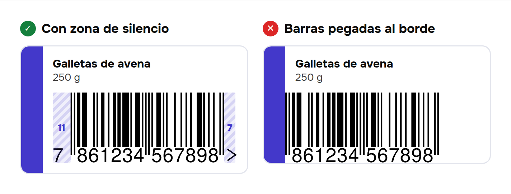
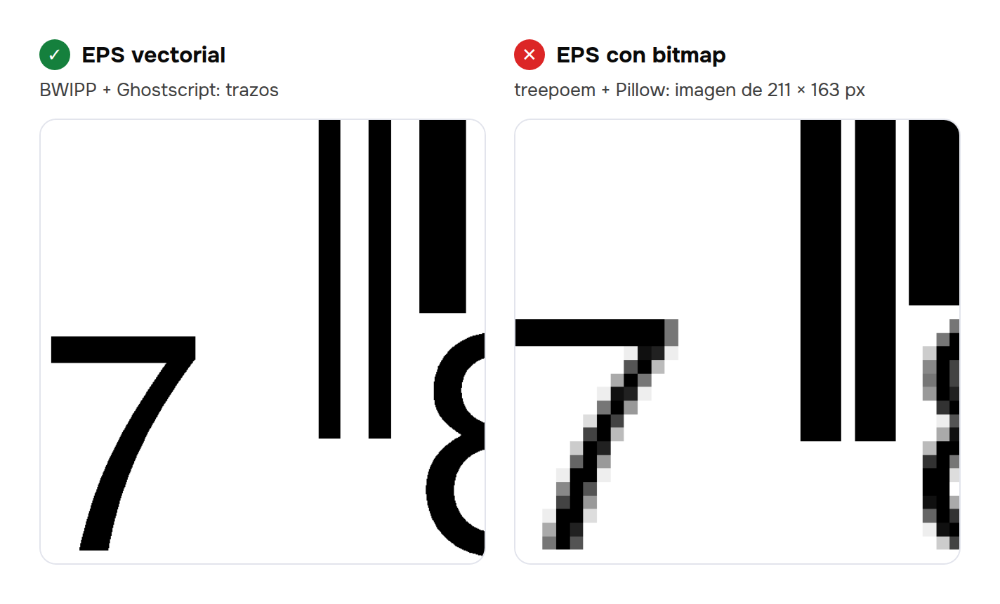
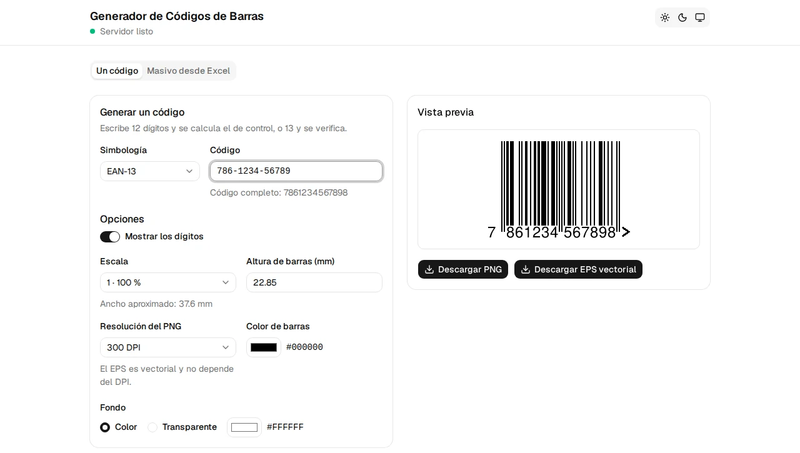

<!-- TODO: contar en 2-3 líneas por qué empezaste el proyecto (¿un cliente, una necesidad propia, una imprenta?). Una anécdota real engancha más que esta intro genérica. -->

Un código de barras parece lo más simple del mundo: unas rayas negras y unos números debajo. Pero cuando construí un [generador de códigos EAN-13](/projects/generador-codigos-de-barras) pensado para imprenta, descubrí que casi todo lo que puede salir mal está en los detalles que no se ven: un dígito que se calcula, un espacio en blanco que nadie dibuja y un archivo EPS que parece vectorial pero no lo es.

En este artículo te cuento cómo funciona un EAN-13 por dentro y cómo terminé generando EPS vectoriales reales desde Python.

## Qué es un EAN-13

Es el código que ves en casi cualquier producto de supermercado. Tiene 13 dígitos que se reparten así:

| Parte | Ejemplo | Qué significa |
|---|---|---|
| Prefijo GS1 | `786` | El país de la organización GS1 que asignó el código (786 es Ecuador) |
| Empresa y producto | `123456789` | Lo asigna GS1 a cada empresa, y la empresa a cada producto |
| Dígito de control | `8` | Se calcula a partir de los otros 12 |

Un detalle importante: **generar la imagen no te da derecho a usar el número**. Para vender en comercios, los códigos tienen que estar asignados por GS1 (en Ecuador, GS1 Ecuador). El generador solo dibuja el código; no lo inventa.

## El dígito de control

El último dígito existe para detectar errores de lectura o de tipeo. Si un escáner lee mal una barra, el dígito de control no coincide y el código se rechaza en lugar de registrar el producto equivocado.

El cálculo usa el algoritmo módulo 10 de GS1:

1. Toma los 12 primeros dígitos.
2. Multiplica cada uno por un peso que alterna **1, 3, 1, 3…** empezando por la izquierda.
3. Suma todo.
4. El dígito de control es lo que le falta a esa suma para llegar a la siguiente decena.

Con `786123456789`:

```text
dígitos:  7  8  6  1  2  3  4  5  6  7  8  9
pesos:    1  3  1  3  1  3  1  3  1  3  1  3
producto: 7 24  6  3  2  9  4 15  6 21  8 27  →  suma = 132
```

La siguiente decena después de 132 es 140, así que el dígito de control es **8** y el código completo es `7861234567898`.

En Python cabe en dos líneas:

```python
def compute_check_digit(body: str) -> int:
    total = sum(int(d) * (3 if i % 2 else 1) for i, d in enumerate(body))
    return (10 - total % 10) % 10
```

El `% 10` del final cubre el caso en que la suma ya es múltiplo de 10: ahí el dígito es 0, no 10.

En el generador, si el usuario escribe 12 dígitos, el sistema calcula el 13.º. Si escribe 13, lo verifica y, si no coincide, le dice cuál esperaba. También ignora espacios y guiones, porque la gente copia los códigos de muchos lugares.

<!-- TODO: si te pasó algo real con esto (un Excel con códigos mal escritos, un cliente con un dígito equivocado), cuéntalo aquí. -->

## Las barras: 95 módulos

La parte gráfica se mide en **módulos**, el ancho de la barra más delgada. Un EAN-13 ocupa siempre 95 módulos:

- **3** del delimitador inicial (barra, espacio, barra).
- **42** para los 6 dígitos de la izquierda (7 módulos cada uno).
- **5** del separador central.
- **42** para los 6 dígitos de la derecha.
- **3** del delimitador final.


¿Y el dígito 13? Ese es el truco más curioso del formato: **el primer dígito no tiene barras propias**. Se codifica de forma indirecta, según qué variante de patrón (llamadas A y B) se usa en cada uno de los 6 dígitos de la izquierda. Así caben 13 dígitos en el espacio de 12.

## La zona de silencio: el espacio que nadie dibuja

Este es el error más común en los diseños que van a imprenta. El escáner necesita un margen en blanco a cada lado para saber dónde empieza y dónde termina el código. GS1 pide **11 módulos a la izquierda y 7 a la derecha**.

Si el diseñador coloca el código al ras de un borde, de un texto o de un fondo de color, el escáner puede fallar aunque el código esté perfecto.



Por eso el generador **siempre incluye la zona de silencio dentro del archivo**: el margen viaja con el código y no depende de que alguien lo respete al maquetar.

## El tamaño físico importa

En impresión no se habla de píxeles sino de milímetros. El tamaño nominal (100 %) de un EAN-13 usa un módulo de **0,33 mm**, y GS1 permite escalarlo, aproximadamente entre el 80 % y el 200 %. Achicarlo más de la cuenta, o recortar la altura de las barras para que "quepa", es otra fuente típica de códigos que no se leen.

El generador permite elegir la escala y la altura de barras en milímetros, y avisa cuando los colores de barras y fondo no tienen suficiente contraste para un lector.

## Generar el EPS: la trampa del bitmap

Las imprentas suelen pedir el código en **EPS vectorial**, para poder escalarlo sin pérdida. Mi primer plan era usar [treepoem](https://github.com/adamchainz/treepoem), una librería de Python que envuelve BWIPP:

```python
image = treepoem.generate_barcode("ean13", "7861234567898")
image.save("codigo.eps")
```

El archivo se genera, tiene extensión `.eps` y se abre sin problemas. Pero **no es vectorial**: `treepoem` devuelve una imagen de Pillow, y guardarla como EPS solo mete un bitmap dentro del archivo. Al hacer zoom en Illustrator o Inkscape, se pixela. Para una imprenta, eso no sirve.



## La solución: BWIPP + Ghostscript

[BWIPP](https://bwipp.terryburton.co.uk/) (Barcode Writer in Pure PostScript) es una librería escrita en PostScript, el mismo lenguaje del que salen los EPS. La idea es dejar de convertir imágenes y **producir el código directamente como PostScript**:

1. Tomar el `barcode.ps` de BWIPP (viene dentro del paquete `treepoem`).
2. Armar un pequeño programa PostScript que llame al codificador `ean13` con los datos y las opciones.
3. Pasárselo a Ghostscript para que lo convierta en EPS.

```bash
gs -dSAFER -dNOPAUSE -dBATCH -sDEVICE=eps2write -dNoOutputFonts \
   -sOutputFile=- -
```

Algunas decisiones que hicieron la diferencia:

- **`-dNoOutputFonts`** convierte el texto (los números bajo las barras) en contornos. Así el archivo no depende de que la imprenta tenga instalada la misma fuente.
- **Todo por stdin y stdout**: el programa entra por la entrada estándar y el EPS sale por la salida estándar. No se escriben archivos temporales en disco.
- **`-dSAFER` y un tiempo límite** en cada llamada, porque Ghostscript ejecuta código PostScript y no conviene darle acceso al sistema de archivos.
- **El tamaño de la página es exactamente el del código con su zona de silencio**, así que el EPS no necesita recortes y el `BoundingBox` queda justo.

El resultado son trazos de verdad: puedes ampliarlo al tamaño de un afiche y las barras siguen nítidas.

<!-- TODO: opcional, para lectores avanzados. En lote, `eps2write` no acepta varias páginas por stdout, así que se usa `ps2write` y se divide el documento en un EPS por código. Decide si vale la pena contarlo o si lo dejas para otro artículo. -->

## Cómo comprobé que funcionaba

No basta con que el archivo "se vea bien". Para confiar en el resultado:

- Los PNG generados se decodifican en los tests con un lector de códigos (`zxing-cpp`), así que si un cambio rompe el código, los tests fallan.
- Los EPS se verifican revisando la cabecera `EPSF`, el `BoundingBox` y que no contengan imágenes rasterizadas.
- Y la prueba final: abrir el EPS en un editor vectorial y hacer zoom.

<!-- TODO: si llegaste a imprimir códigos y escanearlos con un lector real o con el celular, cuéntalo. Es la mejor prueba y la más creíble. -->

## Lo que me llevo

- Un formato que parece trivial puede tener reglas muy precisas. Leer la especificación de GS1 me ahorró muchos errores.
- "Tiene la extensión correcta" no significa "es el formato correcto". El EPS con bitmap pasa cualquier revisión superficial.
- A veces la mejor herramienta es la más antigua: PostScript tiene más de 40 años y sigue siendo la forma más directa de producir vectores para imprenta.



Si quieres probarlo, el [generador está en línea](https://barcode-generator-vert.vercel.app/) y el [código en GitHub](https://github.com/JonnathanE/barcode-generator).
